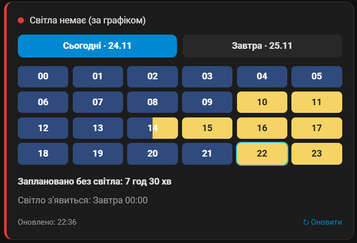

# Графік відключень (Outage Grid Card)



Картка для Home Assistant: сітка графіка відключень світла по годинах (сьогодні / завтра).
Працює з календарем інтеграції [Svitlo Yeah](https://github.com/ALERTua/ha-svitlo-yeah).

## Вимоги

- Home Assistant з Marketplace (HACS)
- Інтеграція Svitlo Yeah з календарем відключень

## Встановлення

1. Відкрийте **Налаштування → Marketplace**.
   (У старіших версіях HA цей розділ називається **HACS** і знаходиться в бічному меню.)
2. Натисніть **«Додати за посиланням»** у правому верхньому куті.
   У старіших версіях: ⋮ → **Custom repositories**, тип **Dashboard**.
3. Вставте посилання на цей репозиторій:

   ```
   https://github.com/otzako/outage-grid-card
   ```

   і натисніть **«Додати»**.
4. У пошуку Marketplace знайдіть **Outage Grid Card**, відкрийте картку та натисніть **Download** (Завантажити).
5. Оновіть сторінку (Ctrl+Shift+R).

Якщо після кроку 3 з'являється повідомлення «already in the Marketplace», репозиторій уже доданий — просто перейдіть до кроку 4.

## Налаштування

1. Відкрийте дашборд → **Редагувати** → **Додати картку**.
2. Знайдіть **Графік відключень (Outage Grid Card)**.
3. У полі **«Календар відключень (Svitlo Yeah)»** виберіть календар вашої черги. Зазвичай потрібен той, що закінчується на **Planned Outages**.
4. За бажанням змініть заголовок і натисніть **Зберегти**.

### Налаштування через YAML

Картку також можна налаштувати вручну (кнопка «Текстовий редактор»):

```yaml
type: custom:outage-grid-card
entity: calendar.ваша_черга_planned_outages  # замініть на свій календар
title: Графік відключень
```

Назву календаря можна подивитися в Інструменти розробника → Стани, фільтр `calendar.`.

## Примітка

Кожна подія календаря вважається відключенням. Якщо в календарі інтеграції є і події «світло є», сітка буде показувати не те.
